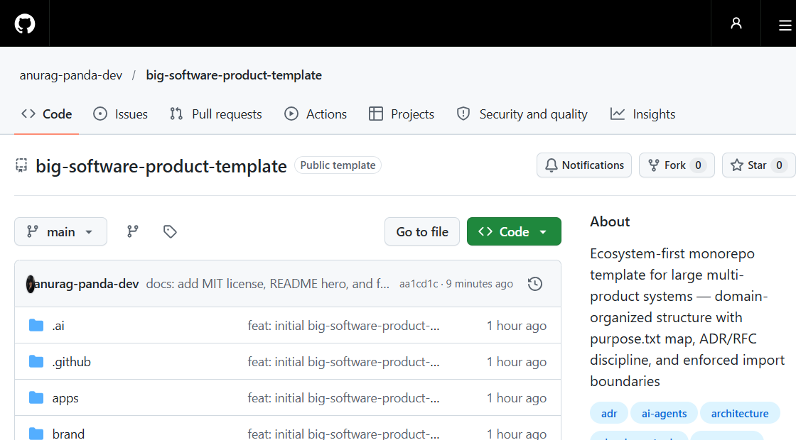

> 🌐 **English** · [বাংলা](README.bn.md)

> **Part of a template family** — use alongside
> [`consumer-hardware-products-template`](https://github.com/anurag-panda-dev/consumer-hardware-products-template) (hardware only) and
> [`full-stack-consumer-hardware-products-template`](https://github.com/anurag-panda-dev/full-stack-consumer-hardware-products-template) (hardware + software).

<h1 align="center">Big Software Product Template</h1>

<p align="center"><b>Every folder explains itself — to humans and to AI agents.</b><br>
268 <code>purpose.txt</code> maps · lint-enforced import boundaries · ADR/RFC decision discipline</p>

<p align="center">
  <a href="LICENSE"></a>
  <a href="https://github.com/anurag-panda-dev/big-software-product-template/generate"></a>
  <a href="https://github.com/anurag-panda-dev/big-software-product-template"></a>
</p>

<p align="center">
  
</p>

```text
apps/            deployables — routes, providers, wiring
categories/      domain verticals ── feature slices {ui, logic, data, api}
crosscutting/    shared-layer products
kernel/          design-system · contracts · auth · offline · i18n · entitlements
platform/        api · payments · notifications · jobs ── never imported from above
datasets/ content/ business/ legal/ docs/ rfcs/ labs/ infra/ sandbox/
```

An ecosystem-first monorepo template for building **large, multi-product software systems** — organized by *domain* (what the product IS) rather than by technical kind (apps/packages soup).

Structure and rationale: see [`docs/decisions/EXAMPLE-ADR-0001-Bongo-Tathya.md`](docs/decisions/EXAMPLE-ADR-0001-Bongo-Tathya.md) — a real ADR from a project built on this layout.

## Rules of thumb

| If it is… | It goes in… |
|---|---|
| Deployable (has a URL/binary) | `apps/` |
| Domain logic of a product | `categories/<category>/<product>/features/` |
| Reusable by everything | `kernel/` |
| A cross-cutting product/layer | `crosscutting/` |
| Backend / not imported by UI | `platform/` |
| Data (raw → curated → verified) | `datasets/` |
| Editorial content | `content/` |
| Business & operations | `business/` |
| Code-adjacent legal | `legal/` |
| Knowledge / decisions | `docs/` (landed) · `rfcs/` (pending) |
| Scratch / prototype | `sandbox/` |

## Structure

```text
apps/           web · admin · pwa · marketing · mobile (RN ⇄ Flutter, stack-neutral)
categories/     one folder per category → one per product → feature slices
crosscutting/   shared-layer products (peer of categories)
kernel/         design-system · contracts · auth · offline · i18n · entitlements · telemetry · config
platform/       api (stack-neutral) · payments · notifications · voice · search · jobs · identity · database · observability
tests/          e2e · contract · visual  (feature slices test themselves)
datasets/       raw → curated → schemas → sources → pipelines → VERIFICATION
content/        style-guide · templates · workflow · library · locale · seo · moderation
business/       product · market-research · marketing · pricing · monetization · finance · metrics · team · support
legal/          compliance · licenses · privacy · templates
docs/           architecture · product · strategy · decisions (+ TEMPLATE.md for new ADRs)
rfcs/           pending architecture proposals
labs/           research (NLP, voice, offline)
infra/          vercel · cloudflare · docker · monitoring
security/       threat model, security policy
tooling/        scripts · codegen
sandbox/        prototypes (never imported by production code)
.ai/ + AGENTS.md  machine-readable conventions for AI agents
```

**Every folder contains a `purpose.txt`** describing what belongs there and what files/subfolders it should hold. Keep them updated as the folder evolves — they are the map.

## Import boundaries (enforced by lint — see PACKAGE.md)

1. `apps/*` → `categories/*`, `kernel/*`, `crosscutting/*`
2. `categories/*` → `kernel/*`, `crosscutting/*`, own `_category/` — **never another category**
3. Features → public `index.ts` of sibling features only
4. `crosscutting/*` → `kernel/*` only
5. `platform/*` → never imported above it (communicates via `openapi/` + `kernel/contracts`)
6. Products never touch payment gateways — they read `kernel/entitlements`
7. `business/`, `legal/`, `docs/` → humans/agents only, never imported by code
8. `logic/` never imports React, HTTP, or database clients

## Using this template

1. **Use this template** on GitHub (or `gh repo create my-project --template anurag-panda-dev/big-software-product-template`)
2. **Rename** — search-replace the project name; update root `README.md`, `purpose.txt`, `AGENTS.md`
3. **Replace the example domain** — `categories/` ships with an example domain (8 categories / 27 products from a real project) to show the pattern. Delete it and create your own categories/products, keeping the layout:
   `categories/<category>/<product>/{product.md, routes/, features/<feature>/{ui,logic,data,api,__tests__}}`
4. **Fill the root workspace** — `package.json`, `pnpm-workspace.yaml`, `turbo.json`, `tsconfig.base.json` (listed in root `purpose.txt`; not shipped so the template stays stack-flexible)
5. **Record your first decision** — copy `docs/decisions/TEMPLATE.md` → `ADR-0001-…`; big choices go through `rfcs/` first
6. **Do not pre-create empty scaffolding** — folders fill as real work arrives (this is an explicit rule of the structure)

## Conventions

- **Decisions:** `docs/decisions/ADR-NNNN-Title.md` (landed, never silently rewritten) · `rfcs/NNNN-title.md` (pending)
- **purpose.txt format:** `PURPOSE:` → `SHOULD CONTAIN:` → `SEE:`
- **Bangla/RTL/other locales:** `kernel/i18n` treats the primary locale as substrate, not a feature — even for English-only projects, formatting and message catalogs live there
- **Stack-neutral hotspots:** `platform/api` (Express ⇄ FastAPI) and `apps/mobile` (RN ⇄ Flutter) defer the choice via RFC — decide later, zero consumer impact
